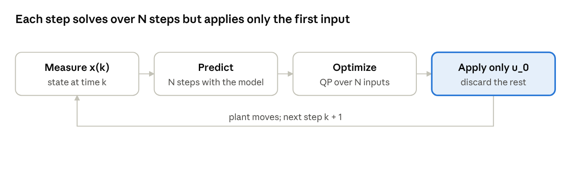

# MPC Theory — Study Notes

2026-10-26 · Anirudh Jamkhandi · [Online version](https://claude.ai/artifact/9SQXQfqQUyaVrbYF1XRdTV)

## 1. Core idea

Model predictive control (MPC) is finite-horizon optimal control, re-solved at every time step from the latest measured state. Each step runs the same loop:

1. **Measure** the current state $x(k)$.
2. **Predict** the system $N$ steps ahead with a model.
3. **Optimize** an input sequence $u_0, \dots, u_{N-1}$ that minimizes a cost and respects constraints.
4. **Apply only $u_0$**, discard the rest, and repeat at $k+1$.

This is the **receding horizon** principle: the prediction window slides forward with time. Because the plan is recomputed from a fresh measurement every step, MPC is a feedback law, not an open-loop plan. Model error and disturbances are corrected at the next step.

What MPC buys over classical controllers: it handles **constraints** (actuator limits, safe state regions) explicitly, works naturally for **multi-input multi-output** systems, and uses **preview** of future references or disturbances when they are known.

## 2. Problem formulation

Standard linear MPC uses a discrete-time linear model and a quadratic cost. The model is:

$$
x_{k+1} = A x_k + B u_k
$$

At every time step, with measured state $x(k)$, solve:

$$
\begin{aligned}
\min_{u_0,\dots,u_{N-1}} \quad & \sum_{i=0}^{N-1} \left( x_i^\top Q x_i + u_i^\top R u_i \right) + x_N^\top P x_N \\
\text{s.t.} \quad & x_0 = x(k) \\
& x_{i+1} = A x_i + B u_i, \quad i = 0,\dots,N-1 \\
& u_{\min} \le u_i \le u_{\max} \\
& x_i \in \mathcal{X} \\
& x_N \in \mathcal{X}_f
\end{aligned}
$$

| Symbol | Meaning |
| --- | --- |
| $Q \succeq 0$ | Stage penalty on state error |
| $R \succ 0$ | Stage penalty on control effort; positive definite keeps the problem strictly convex |
| $P$ | Terminal cost: approximates the cost-to-go after the horizon ends |
| $N$ | Prediction horizon (number of steps) |
| $\mathcal{X}$ | State constraint set (safe region) |
| $\mathcal{X}_f$ | Terminal constraint set |

Tuning intuition: raising $Q$ relative to $R$ gives aggressive, fast control; raising $R$ gives gentle, energy-saving control. A longer $N$ gives better performance and a larger feasible region, at higher computational cost.

## 3. Batch (condensed) form

Eliminating the states turns the MPC problem into a quadratic program (QP) in the stacked inputs alone. Roll the dynamics forward from $x_0$:

$$
x_i = A^i x_0 + \sum_{j=0}^{i-1} A^{i-1-j} B u_j
$$

Stack the predictions $X = [x_1; \dots; x_N]$ and inputs $U = [u_0; \dots; u_{N-1}]$:

$$
X = S_x x_0 + S_u U, \qquad
S_x = \begin{bmatrix} A \\ A^2 \\ \vdots \\ A^N \end{bmatrix}, \qquad
S_u = \begin{bmatrix} B & 0 & \cdots & 0 \\ AB & B & \cdots & 0 \\ \vdots & & \ddots & \vdots \\ A^{N-1}B & A^{N-2}B & \cdots & B \end{bmatrix}
$$

With block-diagonal weights $\bar{Q} = \operatorname{blkdiag}(Q, \dots, Q, P)$ and $\bar{R} = \operatorname{blkdiag}(R, \dots, R)$, the cost becomes a quadratic in $U$:

$$
J(U) = U^\top H U + 2\, x_0^\top F^\top U + x_0^\top Y x_0, \qquad
H = S_u^\top \bar{Q} S_u + \bar{R}, \quad F = S_u^\top \bar{Q} S_x
$$

Input and state constraints are linear in $U$ and $x_0$, so they stack into one inequality:

$$
\min_U \; U^\top H U + 2\, x_0^\top F^\top U \quad \text{s.t.} \quad G U \le w + E x_0
$$

$H \succ 0$ because $R \succ 0$, so the QP is strictly convex with a unique solution. Only $x_0$ changes between time steps; $H, F, G, w, E$ can be built once offline.

The alternative **sparse form** keeps the states as decision variables with the dynamics as equality constraints. It has more variables but banded structure, and it scales better for long horizons.

## 4. Unconstrained case and the link to LQR

Without constraints, MPC reduces to a fixed linear state feedback, and with the right terminal cost it is exactly LQR. Set the gradient of $J(U)$ to zero:

$$
U^\star = -H^{-1} F x_0, \qquad
u_0^\star = -\begin{bmatrix} I & 0 & \cdots & 0 \end{bmatrix} H^{-1} F \, x_0 = K_N x_0
$$

$K_N$ is a constant matrix, so the receding-horizon law is $u = K_N x$. Now choose $P$ as the solution of the discrete algebraic Riccati equation (DARE):

$$
P = A^\top P A + Q - A^\top P B \left( R + B^\top P B \right)^{-1} B^\top P A
$$

Then $x^\top P x$ is the exact infinite-horizon cost-to-go under LQR, and $K_N$ equals the LQR gain $K_\infty = -(R + B^\top P B)^{-1} B^\top P A$ for **any** $N \ge 1$. The horizon no longer matters.

**Constraints are why MPC exists.** With input or state constraints, the optimal law is no longer linear. It is **piecewise affine** in $x$: the state space splits into polyhedral regions, each with its own affine law $u = K_r x + k_r$, one region per set of active constraints. LQR cannot represent this; MPC computes it implicitly by solving the QP online. Explicit MPC (section 7) precomputes the regions offline.

## 5. Why a finite horizon can fail

Re-solving a finite-horizon problem does not automatically give a stable or even well-defined closed loop. Two failure modes exist:

- **Instability (myopia).** The controller sees only $N$ steps. It may pick inputs that look cheap over the window but push the state somewhere costly or unstable just beyond it. Example: with $P = 0$ and a short $N$ on an unstable plant, the optimizer can find it "cheapest" to spend little effort now, and the closed loop diverges. This can happen even without constraints.
- **Loss of recursive feasibility.** The QP has a solution at time $k$, but the state $x(k+1)$ it produces has no feasible input sequence. The controller then has no valid action. Typical cause: the state drifts toward a constraint boundary that the short horizon cannot see how to escape.

A long enough horizon usually hides both problems in practice, but gives no guarantee. Section 6 gives the standard design that guarantees both properties for any $N$, from any state where the first problem is feasible.

## 6. Stability recipe: terminal ingredients

Choose the terminal cost $P$ and terminal set $\mathcal{X}_f$ so the optimal cost $V_N(x)$ works as a Lyapunov function. Then the closed loop is recursively feasible and asymptotically stable (Mayne et al., 2000).

**Ingredients:**

1. A local controller $u = Kx$, usually the LQR gain, that stabilizes the unconstrained system.
2. Terminal cost $P$ = the DARE solution, so $x^\top P x$ is the exact cost-to-go when $u = Kx$ is used forever.
3. Terminal set $\mathcal{X}_f$ that is **positively invariant** under $u = Kx$, and inside which $Kx$ satisfies the input and state constraints. Invariant means: if $x \in \mathcal{X}_f$, then $(A + BK)x \in \mathcal{X}_f$.

**Proof idea: shift and append.** Let $U^\star = (u_0^\star, \dots, u_{N-1}^\star)$ be optimal at $x$, ending at $x_N^\star \in \mathcal{X}_f$. After applying $u_0^\star$, the state is $x^+ = x_1^\star$. Build a candidate for the next problem:

$$
\tilde{U} = \left( u_1^\star, \; u_2^\star, \; \dots, \; u_{N-1}^\star, \; K x_N^\star \right)
$$

- **Recursive feasibility.** The first $N-1$ inputs were already feasible. The appended $K x_N^\star$ is feasible because $x_N^\star \in \mathcal{X}_f$, and it lands in $\mathcal{X}_f$ again by invariance. So the problem at $x^+$ has at least one feasible solution.
- **Cost decrease.** The candidate's cost equals $V_N(x)$ minus the first stage cost, plus a change in terminal cost that is $\le 0$ because $P$ is the LQR cost-to-go. Since the optimum is no worse than the candidate:

$$
V_N(x^+) - V_N(x) \le -\left( x^\top Q x + u_0^{\star\top} R \, u_0^\star \right)
$$

So $V_N$ strictly decreases along closed-loop trajectories, and the origin is asymptotically stable on the set of initially feasible states.

The key terminal condition used above, for all $x \in \mathcal{X}_f$:

$$
\left( (A+BK)x \right)^\top P \left( (A+BK)x \right) - x^\top P x \le -\left( x^\top Q x + x^\top K^\top R K x \right)
$$

With $P$ from the DARE and $K$ the LQR gain, this holds with equality. Practical note: many implementations drop $\mathcal{X}_f$ and use a long $N$ with $P$ from the DARE. Stability then holds only approximately or for large enough $N$.

## 7. Map of MPC variants

Every variant keeps the receding-horizon loop and changes the model, the cost, the uncertainty treatment, or how the problem is solved.

| Variant | What changes | Typical tool or idea |
| --- | --- | --- |
| Nonlinear MPC (NMPC) | Model $x^+ = f(x, u)$ is nonlinear; problem becomes a nonconvex NLP | CasADi + IPOPT, acados; multiple shooting, real-time iteration |
| Tracking MPC | Cost penalizes $x - x_{\text{ref}}$ and $u - u_{\text{ref}}$ instead of distance to 0 | Steady-state target calculation for $(x_{\text{ref}}, u_{\text{ref}})$ |
| Offset-free MPC | Augment model with a disturbance state; estimate it with an observer | Removes steady-state error under constant model mismatch |
| Robust / tube MPC | Bounded disturbance $w$ in a known set; constraints must hold for all $w$ | Nominal trajectory plus an invariant tube; tightened constraints |
| Stochastic MPC | Disturbance has a distribution; constraints hold with high probability | Chance constraints $\Pr(x \in \mathcal{X}) \ge 1 - \varepsilon$; scenario methods |
| Economic MPC | Cost is a general economic objective (profit, energy), not a setpoint distance | Stability via dissipativity instead of a Lyapunov cost |
| Explicit MPC | QP solved offline for all $x$ via multiparametric programming | Online step is a region lookup plus one affine law; small systems only |
| Learning-based MPC | Model, terminal cost, or constraints learned from data | Gaussian-process models, learned value functions, MPC as an RL policy |

## 8. Self-check

Try each question before reading its answer.

**Q1. Why apply only $u_0$ instead of the whole optimal sequence?**

The rest of the sequence was computed from a prediction, and the prediction is wrong as soon as a disturbance or model error appears. Re-solving from the new measurement closes the loop. Applying the whole sequence would be open-loop control, with no correction for anything the model missed.

**Q2. No constraints, $P = 0$, short horizon $N$. Is the closed loop guaranteed stable?**

No. The law is linear, $u = K_N x$, but $K_N$ comes from a truncated cost that ignores everything after step $N$. On an unstable or lightly damped plant, $A + BK_N$ can have eigenvalues outside the unit circle. Stability is guaranteed if $P$ is the DARE solution (then $K_N = K_\infty$ for any $N$), or if $N$ is large enough.

**Q3. In the shift-and-append argument, why must $\mathcal{X}_f$ be invariant under $u = Kx$?**

The candidate appends $K x_N^\star$ as its last input, so its new terminal state is $(A + BK) x_N^\star$. For the candidate to be feasible, that state must lie in $\mathcal{X}_f$ again. Invariance is exactly this property. Without it the candidate could break the terminal constraint, and the recursive feasibility proof fails.

**Q4. Why does $R \succ 0$ matter for the QP?**

It makes $H = S_u^\top \bar{Q} S_u + \bar{R}$ positive definite, so the QP is strictly convex with a unique minimizer. With $R = 0$, $H$ can be singular, the optimal input may not be unique, and solvers can return erratic, chattering inputs.

**Q5. When does the horizon $N$ stop mattering?**

When no constraints are active and $P$ is the DARE solution. The terminal cost then encodes the exact infinite-horizon tail, so every $N$ gives the LQR law. With active constraints, a longer $N$ enlarges the set of feasible initial states and usually improves performance.

## 9. Further reading

Start with Rawlings, Mayne & Diehl for theory and Borrelli, Bemporad & Morari for the linear/explicit side. References are listed from memory and not checked against the sources; verify editions before citing.

| Reference | Why read it |
| --- | --- |
| Rawlings, Mayne & Diehl, *Model Predictive Control: Theory, Computation, and Design*, 2nd ed., 2017 ([free PDF from the authors](https://sites.engineering.ucsb.edu/~jbraw/mpc/)) | Standard graduate text; stability, estimation, robust and economic MPC |
| Borrelli, Bemporad & Morari, *Predictive Control for Linear and Hybrid Systems*, 2017 | Polyhedra, invariant sets, explicit MPC; very clear on the linear case |
| Mayne, Rawlings, Rao & Scokaert, "Constrained model predictive control: Stability and optimality", *Automatica*, 2000 | The paper behind section 6's terminal-ingredient recipe |
| Bemporad, Morari, Dua & Pistikopoulos, "The explicit linear quadratic regulator for constrained systems", *Automatica*, 2002 | Origin of explicit MPC and the piecewise-affine law |
| Grüne & Pannek, *Nonlinear Model Predictive Control*, 2nd ed., 2017 | Nonlinear MPC, including stability without terminal constraints |
| Hewing, Wabersich, Menner & Zeilinger, "Learning-based model predictive control: Toward safe learning in control", *Annual Review of Control, Robotics, and Autonomous Systems*, 2020 | Survey linking MPC with learning and reinforcement learning |
